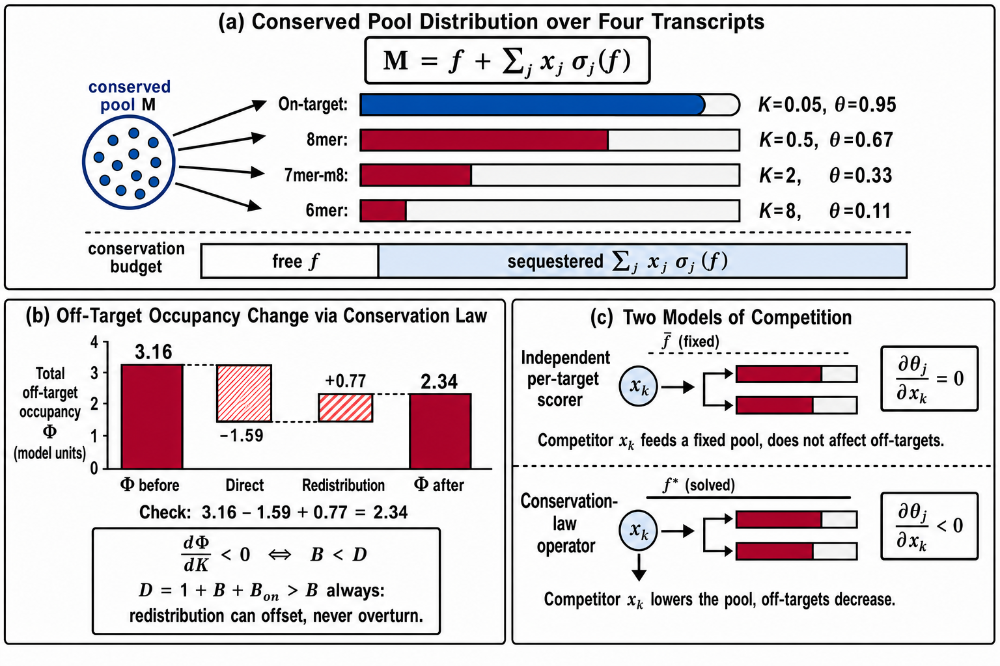

# Certified Comparative Statics for Conservation-Law Equilibrium Layers, with an Application to siRNA Off-Target Competition

Interpretable modeling of siRNA seed-mediated off-target activity and competitive
endogenous RNA (ceRNA) derepression, built on a certified conservation-law equilibrium
operator with provable comparative statics. The Python package is importable as `cel`.

This work extends CCMP (FiLM-conditioned per-concept heterogeneous message passing, K=9
concept channels) and preserves its by-construction zero cross-concept leakage property
(L_k = 0). The full project contract, including hard engineering rules, lives in
[OUTLINE.md](OUTLINE.md).

## The certified operator

A limited guide pool is shared across all target sites. The single-pool equilibrium

```
M = f + sum_i x_i * sigma(f, K_i),   sigma(f, K) = f / (K + f)
```

is solved for the free guide `f` by bisection on the monotone residual (never a Picard
map). The reduced residual Jacobian `D = 1 + sum_i x_i * sigma'(f) >= 1` is a nonsingular
M-matrix by construction, which certifies the SIGN of every comparative static: raising a
competitor's abundance lowers every other site's equilibrium occupancy (competitors couple
only through the shared pool). Magnitude is not claimed; only the certified sign is. The
closed-form comparative static is checked against a finite-difference re-solve to ~1e-6.

## Experiments

Every script is deterministic and bitwise-reproducible on rerun, reads only real measured
data (loaders raise on missing input, no synthetic fallback), is ruff clean, and contains
no em-dashes. Run any of them directly with `python scripts/<name>.py`.

| area | script(s) | output |
|---|---|---|
| Certified-direction panel (seed-matched vs background KS attenuation) | `certified_panel_filtered.py`, `make_fig2.py` | `results/figures/fig2_certified_panel.pdf` |
| Panel statistics: bootstrap CIs, permutation null, isoform fragility | `panel_statistics.py` | `results/panel_statistics.json` |
| Second (non-biological) instantiation: competitive Langmuir adsorption | `adsorption_operator.py`, `make_fig4_adsorption.py` | `results/adsorption_operator.json`, `results/figures/fig4_adsorption.pdf` |
| Symbolic == code == numeric Jacobian consistency (adsorption) | `verify_adsorption_jacobian.py` | stdout |
| Held-out derepression (Denzler 2016 quantitative, Mukherji 2011 qualitative) | `derepression_heldout.py` | `results/derepression_heldout.json` |
| Trainable certified-monotone equilibrium layer on McGeary GSE140217 | `learned_layer.py` | `results/learned_layer.json`, `results/figures/fig5_learned_layer.pdf` |
| Read-only recovery of the trainable-layer reproducibility fields | `recover_training_fields.py` | stdout + `app:training` LaTeX |
| 1B decision example: scorer-blind, operator- and Denzler-resolved miR-122 titration | `decision_example.py` | `results/decision_example.json` |
| Table 3: coupled supermodularity vs isolated submodularity of g(S) | `verify_table3_submodularity.py` | stdout |
| Certified comparative-statics theory verified at scale on the real corpus | `theory_realdata_verification.py` | `results/theory_realdata_verification.json` |

Key results: the certified sign holds where testable and sourced; the operator is
domain-general (the M-matrix comparative static holds on a purely physical adsorption
instance, 4/4 measured antagonism steps matched); the held-out derepression thresholds are
predicted within an order of magnitude from copy numbers alone; and the certified
monotonicity survives learning (the trainable layer keeps `D > 0` at every training step
while reaching magnitude parity with a same-capacity feedforward baseline that structurally
cannot express competitor coupling).

## Figures

### Operator schematic



How the certified operator works, on a four-transcript instance (one on-target plus 8mer,
7mer-m8 and 6mer seed off-targets).

(a) The conserved pool `M` splits into free guide `f` and the guide sequestered by every
site, `sum_j x_j sigma_j(f)`. Weaker seed matches carry larger `K_j` and therefore lower
equilibrium occupancy `theta_j`, so the whole occupancy profile is set by the single scalar
`f`.

(b) A change in the on-target affinity `K` moves total off-target occupancy `Phi` through
two terms that the conservation law forces to have opposite signs: a direct effect and a
redistribution effect routed through the shared pool. Because the reduced Jacobian obeys
`D = 1 + B + B_on > B`, redistribution can offset the direct effect but can never overturn
it, which is what pins the sign of `dPhi/dK`.

(c) The capability contrast that the rest of the repository tests. An independent
per-target scorer holds the pool fixed, so a competitor `x_k` leaves every off-target
untouched (`d theta_j / d x_k = 0`). The conservation-law operator solves for `f*`, so the
same competitor lowers the pool and every off-target occupancy strictly decreases
(`d theta_j / d x_k < 0`). Panel (c) is the mechanism behind the learned-layer capability
contrast in the last figure below.

### Certified-direction panel


Seed-matched vs background log2 fold-change ECDFs across the certified panel. The KS
attenuation separates the arms where the certified sign is testable and sourced (for
example Ttr under GNA versus the trivial Hao1 arm).

### Second instantiation: competitive Langmuir adsorption


Measured (Heliyon 2024) versus operator loading of each adsorbate as the competitor
concentration is swept. The certified sign `dq_target/dC_competitor < 0` matches every
measured antagonism step (4/4); the shaded band is the disclosed, uncertified magnitude
gap. This is a purely physical, non-biological instance of the same M-matrix comparative
static, showing it is domain-general and not an RNAi artifact.

### Trainable certified-monotone equilibrium layer


Left: held-out mean per-microRNA Spearman over training, equilibrium layer versus a
same-capacity feedforward baseline (magnitude parity). Right: the capability contrast. The
baseline is structurally flat (`d pred / d competitor abundance = 0`, competitor is not an
input) while the equilibrium layer has a strictly negative slope, the Proposition-2
derepression direction, now for a learned layer against a learned baseline of equal
capacity. The certified monotonicity condition `D > 0` holds at every training step.

## Quickstart

```bash
make dev     # install with dev extras + pre-commit hooks
make lint    # ruff check + format check + em-dash scan
make test    # pytest
make repro   # reproduce all headline numbers from cached data
```

## Layout

See [OUTLINE.md](OUTLINE.md) for the canonical repository layout.

## Reproducibility

Every theorem has a matching verification script under [verify/](verify/) or `scripts/`,
and every experiment fixes and records its seeds. Reruns are bitwise identical (md5 printed
where a run emits an artifact). No network access is required to reproduce the headline
numbers from cached data.
